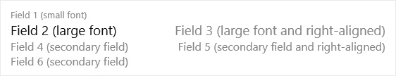

# Mobile Pages

The table contains all the pages and lists used in both [JobManager Mobile](../daily-use/mobile-role-center.md) and the deprecated [Mobile Registration Client App](../mobile-registration-client-app/README.md).

_The table has previously been referred to as: App Pages._

# JobManager Mobile

All those in the list that have the '#' prefix are for [JobManager Mobile](../daily-use/mobile-role-center.md).

Specify which fields are to be displayed in the respective lists. The sort indicates where/how the field is displayed in the list. See illustration below.

**#JOBMANMOBANSWERCOLLECTLIST** is for the list of questions when answering a questionnaire.

**#JOBMANMOBITEMLIST** is for the selection list of items.

**#JOBMANMOBITEMCONSUMPTIONLIST** is for the list of _Item Consumption_.

**#JOBMANMOBPICKJOBLIST\_?** is for the selection list used from _Time Sheet_. Subfix indicates the type of job (eg. \_ASSEMBLY for Assembly Order).

**#JOBMANMOBREGACTIVEJOBSLIST** is for the list of _Active Jobs_ under _Registration_.

**#JOBMANMOBREGJOBLIST\_?** is for the lists of jobs, which can be found under _Registration_. Subfix indicates the type of job (eg. \_ASSEMBLY for Assembly Order).

**#JOBMANMOBREGJOURNAL** is for the _Time Sheet_ list.

# Mobile App for registration (discontinued)

All WITHOUT '#' prefix are for the depricated [Mobile Registration Client App](../mobile-registration-client-app/README.md).

[Key](./key.md)  
[Sum (Percent)](./sum-percent.md)  
[Unit](./unit.md)  
[Sorting Order](./sorting-order.md)  

## See also

[Mobile Role Center](../daily-use/mobile-role-center.md)  
[Mobile Registration Client App](../mobile-registration-client-app/README.md)
