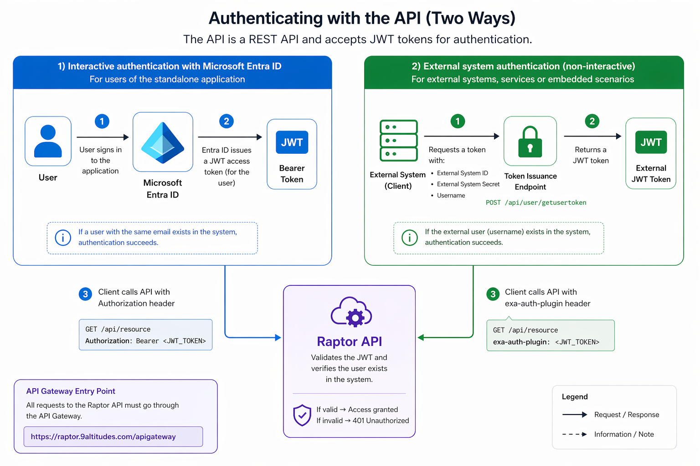

# API Guide

## 1.    Introduction

Welcome to the Raptor Document Warehouse API (aka Raptor API) documentation.

The Raptor API is a RESTful service that provides programmatic access to your document warehouse, enabling seamless integration with external systems and custom applications. It is available at the following endpoint:

[**https://raptor.9altitudes.com/apigateway**](https://raptor.9altitudes.com/apigateway)

With this API, you can efficiently manage documents and related data through a wide range of operations. These include searching and retrieving documents, uploading and downloading files, organizing content using tags, and managing users and system configuration.

To explore the available endpoints and understand how to use them, refer to the [**Swagger** ](https://raptor.9altitudes.com/apigateway/swagger)(OpenAPI) documentation. It provides an interactive overview of all API operations, request/response formats, and authentication requirements, allowing you to test and integrate endpoints efficiently.

## 2.    Authentication

There are two ways of authenticating with the Raptor API:

\-            Using Microsoft Entra ID

\-            Using external system authentication

<figure><figcaption></figcaption></figure>


Authentication example\
▎ # 1. Get a token (GET, query parameters)\
▎ curl "https:///apigateway/api/User/getusertoken?externalSystemID=\&secret=\&externalUserName=\&ttlDays=1\&validate=true"\
\
▎ # 2. Use it in the exa-auth-plugin header (not Authorization: Bearer)\
▎ curl -H "exa-auth-plugin: " "https:///apigateway/api/meta/document//content" -o file.pdf

### Using Microsoft Entra ID

This type of authentication is generally only used by the Raptor web application ([https://raptor.9altitudes.com](https://raptor.adultimagroup.com)). \
When loading the website, the user will be asked to login with their Microsoft account. The system will check for a Raptor user with a matching email address and provide access to all Raptor tenants which this is user is a member of.

You can use this type of authentication to test the [Swagger](https://raptor.9altitudes.com/apigateway/swagger) endpoints.\
Click the **Authorize** button (top right), select the **access\_as\_a\_user** scope, and then click **Authorize** again to sign in with your Microsoft account.

<figure><figcaption></figcaption></figure>

In the **membership-selector** section, you can optionally specify the tenant ID you want to connect to. If no tenant ID is provided, the default tenant will be used.

You can find the tenant ID of a Raptor tenant in the **About** section.

### External system authentication

You can integrate with the Raptor API from your own application by creating an [**External system**](../raptor-document-warehouse/configuration/external-systems.md) in the Configuration panel. The external system represents your application and provides a unique ID along with two secrets (a primary and an alternate).

These two secrets allow for secure rotation: if one secret is compromised or needs to be replaced, you can switch to the alternate secret while regenerating the other, ensuring uninterrupted operation.

Users can be linked to this external system, allowing them to authenticate using the combination of the external system ID, one of its secrets, and their username.

#### Requesting a token

Once you have set up an external system, you can obtain an authentication token by calling the endpoint **/api/user/getusertoken**.

**Parameters:**

* **externalSystemID**: The identifier of the external system
* **secret**: The primary or secondary secret associated with the external system
* **externalUserName**: The username in the external system (available under the [External Systems](../raptor-document-warehouse/configuration/external-systems.md) tab in the Configuration panel)
* **ttlDays** _(optional)_: Token validity period in days
* **ttlHours** _(optional)_: Token validity period in hours
* **ttlMinutes** _(optional)_: Token validity period in minutes
* **validate** _(optional)_: If set to `true`, checks whether the generated token is valid

## 3.    Searching documents

The querydocuments API allows you to retrieve documents based on tags, metadata, and advanced filtering logic. It is designed to support both simple lookups and complex search scenarios.

```
POST /api/meta/document/querydocuments
Example request payload:
{
  "obligatoryTags": ["3fa85f64-5717-4562-b3fc-2c963f66afa6"],
  "tagsInHierarchy": ["3fa85f64-5717-4562-b3fc-2c963f66afa6"],
  "fieldQueryExpression": {
    "operator": "string"
  },
  "orderBy": 0,
  "sortableFieldId": "3fa85f64-5717-4562-b3fc-2c963f66afa6",
  "includeTotalCount": true,
  "name": "string",
  "containsName": "string",
  "orderAscending": true,
  "continuationToken": "string"
}

```

### Core filtering options

#### Tag-based filtering

Tags are the primary way to filter documents.

* **`obligatoryTags`**\
  These are **mandatory tags**.\
  Only documents that contain _all_ specified tags will be returned.
* **`tagsInHierarchy`**\
  These represent **parent tags**.\
  Documents will be returned if they contain:
  * the specified tag, **or**
  * any of its **child tags**

This is especially useful when working with hierarchical taxonomies (e.g., project structures in D365).

#### Name-based filtering

* **`name`**\
  Searches for documents with an **exact match**.
* **`containsName`**\
  Searches for documents where the name **contains** the given string.

Use `containsName` for more flexible, user-friendly searches.

### Advanced querying

#### `fieldQueryExpression`

This parameter enables **complex filtering logic** across document fields.

* Supports advanced operators and combinations
* Typically generated via the UI and exported as JSON
* Recommended approach:
  * Build your query in the UI
  * Copy the generated JSON into this parameter

⚠️ **Important:**\
Avoid combining `fieldQueryExpression` with other filters unless you fully understand how they interact, as this can lead to unexpected results.

### Sorting results

#### `orderBy`

Controls how results are sorted:

* `0` → No ordering
* `1` → Document name
* `2` → File size
* `3` → Created date
* `4` → Custom sortable field (requires `sortableFieldId`)

#### `sortableFieldId`

* Required when `orderBy = 4`
* Specifies which field to sort on

#### `orderAscending`

* `true` → Ascending order
* `false` → Descending order

### Pagination

#### `continuationToken`

When a query returns many results, pagination is applied.

* The response may include a **continuation token**
* Pass this token in the next request to retrieve the next page

This allows efficient handling of large datasets without overloading the response.

### Additional options

* **`includeTotalCount`**\
  When set to `true`, the response includes the **total number of matching documents**, not just the current page.

## 4.    Creating and retrieving tags

Tags are the beating heart of the Raptor solution. They ensure that documents are properly classified, easily retrievable, and logically grouped. Beyond organization, tags also play a critical role in security by controlling document visibility and ensuring that content is accessible only to the appropriate audiences.

Within the document lifecycle, tags can be added, updated, or removed at any time, allowing for flexible and dynamic document management.

### Retrieving tags

Tags can be retrieved using either their unique **ID** or their **Code**:

* The **ID** represents the environment-specific instance of a tag. It is unique per environment.
* The **Tag Code** is a reusable identifier that can remain consistent across multiple environments.
* Tag codes follow a fixed, human-readable format designed to allow API consumers to easily reference tags without needing to store environment-specific IDs internally.

### Creating tags

There are two supported ways to create tags:

* **Manual creation**\
  You can create a tag by explicitly providing:
  * a tag code
  * translated label(s)
  * a parent tag
*   **Creation via Entity Configuration**\
    You can also create tags through the Entity Configuration by supplying business context as input. If an Entity Configuration is set up, it will automatically determine how to create the tag based on predefined rules.

    This approach allows tags to be generated without needing to know the exact tag code format or parent structure in advance.

<figure><figcaption></figcaption></figure>

## 5.    Commonly used endpoints

Below a description of a few commonly used endpoints:

<table data-header-hidden><thead><tr><th width="288.72735595703125"></th><th></th></tr></thead><tbody><tr><td>Uploading a document</td><td><em>POST /api/meta/document/content</em></td></tr><tr><td>Downloading a document</td><td><em>GET /api/meta/document/{documentId}/content</em></td></tr><tr><td>Adding a tag</td><td><em>POST /api/meta/document/{documentId}/tag/{tagId}</em></td></tr><tr><td>Removing a tag</td><td><em>DELETE /api/meta/document/{documentId}/tag/{tagId}</em></td></tr><tr><td>Get a field by ID</td><td><em>GET /api/taxonomy/fields/{fieldId}</em></td></tr><tr><td>Get a field by code</td><td><em>GET /api/taxonomy/fields/field?code={code}</em></td></tr><tr><td>Adding a field</td><td><em>POST /api/meta/document/{documentId}/field</em></td></tr><tr><td>Removing a field</td><td><em>DELETE /api/meta/document/{documentId}/field/{fieldId}</em></td></tr><tr><td>Searching documents</td><td><em>POST /api/meta/document/querydocuments</em></td></tr><tr><td>Get a tag by ID</td><td><em>GET /api/taxonomy/tags/{tagId}</em></td></tr><tr><td>Get a tag by code</td><td><p><em>GET /api/taxonomy/tags/tag?code={code}</em></p><p> </p></td></tr><tr><td>Create a tag manually</td><td><em>POST /</em>api/taxonomy/tags?method=get-or-create<br>Other options: create-new, create-or-update.</td></tr><tr><td>Create a tag via Entity Configuration</td><td><em>POST api/integration/resolvecontext</em></td></tr></tbody></table>

## 6.    Postman collection

Below, you’ll find a Postman collection and environment that include sample requests for interacting with the Raptor API.





