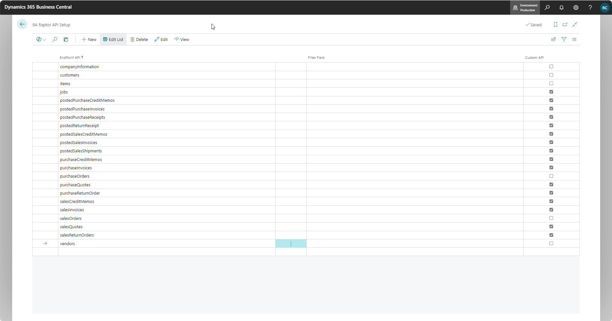
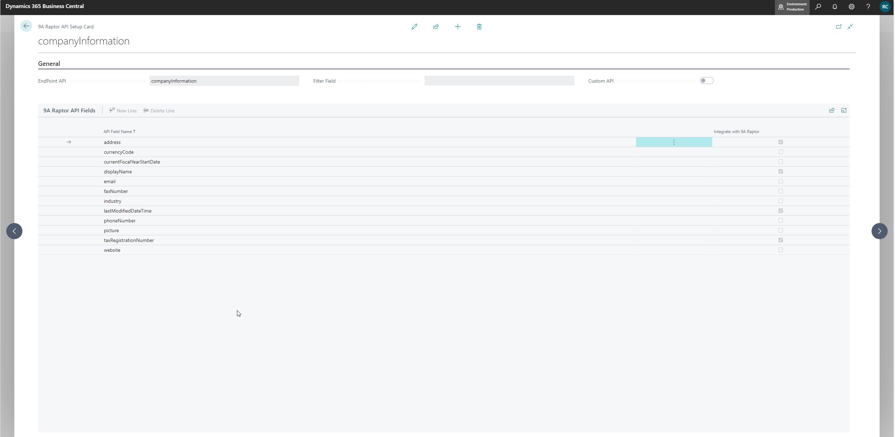
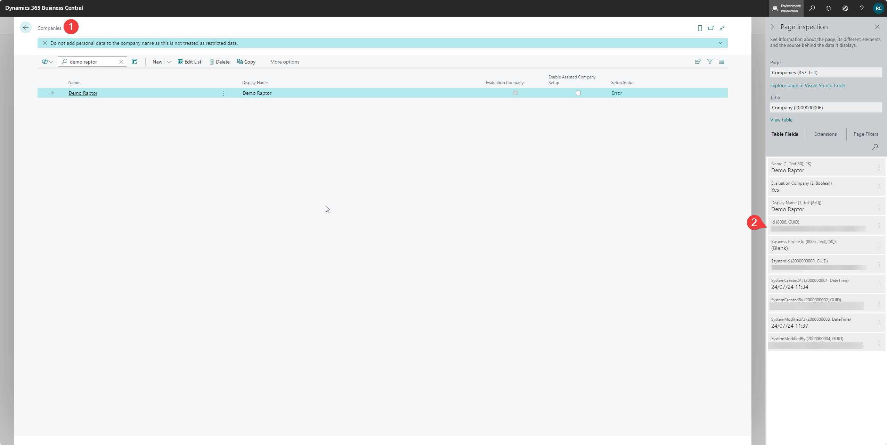

# Configuration: 9A Raptor Pages

Tell me function: '9A Raptor'

<figure><figcaption></figcaption></figure>

* 9A Raptor API Setup
* 9A Raptor Webservices Log
* 9A Raptor Integration Setup
* 9A Raptor Setup (Package) List
* 9A Raptor Email Scenario Setup
* 9A Raptor Document History List
* 9A Raptor Integration Scenarios
* 9A Raptor Document Distribution Setup

## 9A Raptor API Setup&#x20;

This page specifies the API endpoints that Raptor can use to fetch table data&#x20;

* The list will be prefilled with the default API endpoints&#x20;
* Additional custom API's can be added by a BC technical consultant&#x20;

<figure><figcaption></figcaption></figure>

* Verify if the right API's are checked as custom API
* Endpoint API: API endpoints that Raptor can use to fetch data&#x20;
* Filter Field: Leave blank&#x20;
* Custom API: this check specifies if the data should be fetched from the default API endpoint or from the Raptor API endpoint&#x20;
  * Unchecked: uses the default API endpoint: /api/v1.0/ (before BC21) or /api/v2.0/ (BC21 and onwards)&#x20;
  * Checked: uses the custom Raptor API endpoint: api/raptor/custom/V1.0/

Select an endpoint: 9A Raptor API Setup Card

* Specify the fields for which you want to track tags
* This is necessary for entity config&#x20;
* This is for you to decide&#x20;

<figure><figcaption></figcaption></figure>

This needs to be linked one-to-one with the **entity configuration in Raptor**, otherwise the filtering won't work.&#x20;

## 9A Raptor Webservices Log&#x20;

<figure><figcaption></figcaption></figure>

* This is a logging table for errors and the reason a document couldn't be uploaded to Raptor document warehouse.&#x20;

## 9A Raptor Integration Setup&#x20;

<figure><figcaption></figcaption></figure>

**General**: see 'Configuration Raptor - BC [https://app.gitbook.com/o/bqSIsQqz4U4PqAwwBN3A/s/Kfypi8e8luNHtfjQhy6p/\~/changes/145/integrations/d365-business-central/configuration-raptor-bc#id-3.-9a-raptor-integration-setup](set-up-integration-raptor-bc.md#id-3.-9a-raptor-integration-setup)

**Event Management**&#x20;

* Created By System Tag: Tag for Raptor Documents created by printing document from Business Central.
* Delete Incoming Document Attachments:  The tag will be used to exclude such documents from being attached to outgoing emails.
* Legal entities Tag: choose a legal entity tag from the taxonomy&#x20;
  * Used for advanced filtering (output management): link documents based on the legal entity

**Email Management**: Enable integration of Raptor with the base Business Central emailing framework.

**Input Management**: Enable certain fields for Raptor setup in Continia document journals.&#x20;

* Partially switches off certain Continia functionalities and uses Raptor document warehouse in replacement
* More about this on the following page: [https://app.gitbook.com/o/bqSIsQqz4U4PqAwwBN3A/s/Kfypi8e8luNHtfjQhy6p/\~/changes/160/integrations/d365-business-central/input-management](input-management-continia.md)

**Action: Navigate**&#x20;

<figure><figcaption></figcaption></figure>

* 1\) go to 9A Raptor Integration Scenarios - page&#x20;
* 2\) go to 9A Raptor Email Scenario Setup - page&#x20;
* 3\) go to 9A Raptor Email Scenario Setup - page&#x20;
* 4\)  go to Languages - page : this is crucial for the setup of the advanced filtering for output management
  *   NAL Raptor Language Tag: add the corresponding language tag

      <figure><figcaption></figcaption></figure>
  * Advanced filtering for output management: filter attachments based on the language tag
    * Don't forget to add a language code to your customers or vendors if you want to start filtering based on language tag!&#x20;
* 5\) go to 9A Raptor Document Distribution Setup - page &#x20;

## 9A Raptor Setup (Package) List

This page defines packages that can be requested by a Raptor Taxonomy job. This taxonomy job ensures that new tags for certain entities are created regularly and at a fixed time.&#x20;

For each package you can specify the API endpoints that need to be included. You can choose the API endpoints from the list on the ‘9A Raptor API Setup’ page. The package code will be defined in the taxonomy job.

<figure><figcaption></figcaption></figure>

### _1. Business Central_&#x20;

<figure><figcaption></figcaption></figure>

1\) This is an example of the setup for a taxonomy job for entities customers, items and vendors.

2\) view API fields&#x20;

* Make sure each API field has the right name, because this is linked with the entity configuration setup in raptor
*

    <figure><figcaption></figcaption></figure>

3\) Delta Migration&#x20;

* For each API In the package we can also specify if all data from the endpoint should be forwarded, or only newly modified/created data (= Delta Migration)
* This setting should be turned on after a full sync by the taxonomy job was completed. If left turned off, the taxonomy job might take exponentially more time as it needs to re-sync all data In the system every time

4\) Last Export DateTime&#x20;

* Specifies when the taxonomy job last ran&#x20;

### _2. Raptor : taxonomy job_&#x20;

<figure><figcaption></figcaption></figure>

Configuration -> jobs -> add a new job&#x20;

General&#x20;

* Cron Schedule: specifies when a job will be executed, according to a specific time schedule
  * Set this up using a site like [https://crontab.cronhub.io/](https://crontab.cronhub.io/)&#x20;
* On behalf of: fill in a user&#x20;
* Delta packager: 'Default Packager'
* Legal Entity: your environment&#x20;

Authentication&#x20;

* OAuth 2.0&#x20;
* Active Directory Tenant: https://login.microsoftonline.com/**\<tenantID>**
* Client app id: Azure Application ID&#x20;
  * See Business Central: Microsoft Entra Application-page (don't forget to remove the brackets)&#x20;
* Client app secret: Azure app registration secret
* Azure resource: always "https://api.businesscentral.dynamics.com"&#x20;

Delta Fetch Settings&#x20;

* Package ID: package code from the 9A Raptor Setup (Package) List-page
* Uri: https://api.businesscentral.dynamics.com/v2.0/**\<Environment Name>**&#x20;
  * e.g. Production
* Raptor Base Path: /api/raptor/custom/v1.0/
* Entity Path: /api/v2.0/&#x20;
* Company ID: look up in BC&#x20;
  * Companies -> Select company -> Ctrl + Alt + F1 -> 'Id'&#x20;
  *

      <figure><figcaption></figcaption></figure>

Save and activate &#x20;

**note**: if the job isn't working, try adding the following permission set to the Microsoft Entra Application Card

*

    <figure><figcaption></figcaption></figure>

## 9A Raptor Email Scenario Setup (output management) &#x20;

First of all: make sure you enable email management on the 9A Raptor integration setup - page

<figure><figcaption></figcaption></figure>

This 9A Raptor Email Scenario Setup - page specifies more functionalities for output management (documents made with BC)&#x20;

<figure><figcaption></figcaption></figure>

* 1\) Email scenarios for different documents: sales quote, sales order, posted sales invoice, posted sales credit memo, purchase quote, purchase order, sales credit memo
* 2\) you can predefine the addressees by scenario (to, CC, BCC)
* 3\) you can predefine subject and attachment name (from the email) by scenario and there are placeholders provided
  * The following placeholders are available:&#x20;
  * '%COMPANYNAME%' = the name from Company Information&#x20;
  * '%DOCTYPE%' = the Document Type
  * '%DOCNO%' = the Posted Document Number
  * '%PARTNERNO%' = the internal identification number of the recipient Customer/Vendor
* Attachments
  * 4\) Tags: documents with this tag will be added as an attachment&#x20;
  * &#x20;5\) Advanced filtering: filter out some documents that will be included in the mail&#x20;
    * Link to record: only use documents with the requested tags that are related to the same record as the entity
      * e.g.: all the sales shipments (attachment) linked to the posted sales invoice (record)&#x20;
    * Link to company: only use documents with the requested tags that have the same legal entity tag as the record
      * (set up on the 9A Raptor integration setup - page)&#x20;
    * Link to language: only use documents with the requested tags that have the same language tag as the record
      * (set up on the 9A Raptor integration setup - page) &#x20;

## 9A Raptor Integration Scenarios&#x20;

<figure><figcaption></figcaption></figure>

This page specifies the entities on which an integration is built

### _1. Copy setup from other company_

<figure><figcaption></figcaption></figure>

You can also copy the integration scenarios from another company within the tenant.&#x20;

* The list of scenarios must be empty to do this.&#x20;
* At this moment, the API fields are not copied along. So, don't forget to fill in the API fields on the integration scenario card when you copy from another company.&#x20;
  * You can do this by configuration package: table ID = 2057757 (NAL Raptor Integration Field)
  * Important! : The primary key is not the first field in this table. When importing the configuration package, make sure to do this without validation.&#x20;
  *

      <figure><figcaption></figcaption></figure>

### _2. 9A Raptor Integration Scenario Card_&#x20;

<figure><figcaption></figcaption></figure>

For each entity, you can determine which tags/metadata a document receives

#### **General**&#x20;

* Integration Scenario: choose the right scenario (this is hard coded)
* Enable: enable scenario
* Save Attachments to Raptor Side
* Use Specific Document Tags&#x20;
* Document Template Code
  * You can choose from the list on raptor.9altitudes.com -> configuration -> templates&#x20;
  * A template is a logical combination of multiple tags

#### Event Management&#x20;

* FastTab available only for entities where you create documents&#x20;
* Specifies when you want to generate/save documents to the document warehouse&#x20;
* e.g. purchase order&#x20;
*

    <figure><figcaption></figcaption></figure>

* The actions vary depending on the document and what actions you can take to make this document&#x20;

#### Page Management&#x20;

* Show actions on card/list page: specify if action 'View Raptor Documents' is visible (on card or list) (1)&#x20;
* Show section on card/list page: specify if the 9A viewer is visible (on card or list) (2)&#x20;
  * Show section on list page: you can also choose how you want to see the 9A viewer. You can turn the viewer off, make it visible as a section at the bottom or in the factbox at the right
  *

      <figure><figcaption></figcaption></figure>
*

    <figure><figcaption></figcaption></figure>
*   9A viewer in the factbox:&#x20;

    <figure><figcaption></figcaption></figure>

#### Integration API&#x20;

* Entity Name: to which entity (from the 9A Raptor API Setup) do you link the scenario&#x20;

#### Raptor Viewer Options

**Display & Layout Control**

Here you can choose how you want the viewer to display the information.&#x20;

<figure><figcaption></figcaption></figure>

* Default: Standard view, preview pane is visible for details or viewing the document.
* Compact: Preview pane is initially hidden, showing only the document list. Once you click on the arrow at the right of the viewer, the preview pane becomes visible.&#x20;
*

    <figure><figcaption></figcaption></figure>

**Advanced Control**

These fields are turned off and not visible by default. When you want to modify these options, you will have to add the fields through personalisation.&#x20;

<figure><figcaption></figcaption></figure>

_Button & Action Control_&#x20;

* Disable Upload: Hide the upload button to prevent users from uploading new documents
* Disable Download: Hide the download button to restrict document downloads
* Disable View: Hide the view button (opens preview in new tab/window)
* Disable Email: Hide the email button to prevent document email distribution
* Disable Copy: Hide the copy button to prevent document duplication
* Disable Delete: Hide the delete button to protect documents from removal

_Advanced Feature Control_&#x20;

* Disable Context Detach: Prevent users from detaching documents from the current Business Central context
* Disable External Source: Disable the ability to use external document sources
* Disable Document Triggers: Disable automatic document triggers in the viewer
* Disable Tenant Name: Hide the tenant name display in the viewer
* Disable Search bar&#x20;

_Security & Compliance_&#x20;

* Readonly Mode: Enable full readonly mode, preventing all modifications to documents

#### Integration API Fields&#x20;

* Which fields do you want to create tags from: link field Names with tags (that you set up in the 9A Raptor API Setup)
* Check the field 'Integrate with 9A Raptor'&#x20;

## 9A Raptor Document Distribution Setup

Document Distribution Routes enable documents to be transferred/copied between entities, while preserving their history through tags.

More information on the functionality and the configuration can be found on the following page:&#x20;

[https://docs.raptor.9altitudes.com/9a-document-management/\~/revisions/EdcJ0dgsyt3pc3Pe8tih/integrations/d365-business-central/document-distribution-routes](https://docs.raptor.9altitudes.com/9a-document-management/~/revisions/EdcJ0dgsyt3pc3Pe8tih/integrations/d365-business-central/document-distribution-routes)&#x20;
