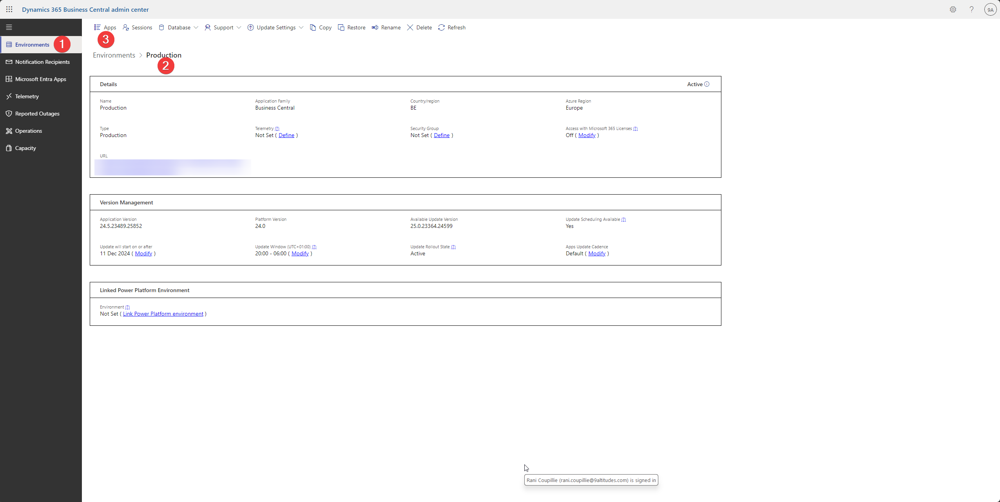
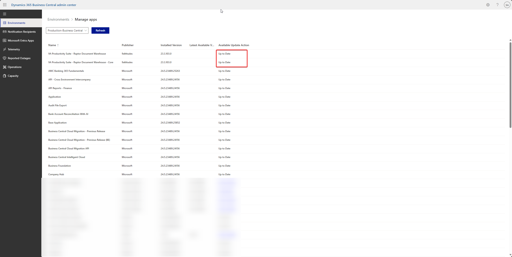

# Installation/maintenance

## How to install the app in Business Central&#x20;

Make sure you are admin so you can install apps on the environment&#x20;

### 1. Install the app&#x20;

App = 9A Productivity Suite - Raptor Document Warehouse

App ID = 542d89ec-8831-4bfc-9c53-63bbc506e026

When you want to install the app as a partner, use the direct URL: append the following to the base Business Central URL in the address bar&#x20;

* ?aid= FIN\&page=2503\&filter=%27ID%27%20IS%20%2&#x37;**\<App ID>**%27\&signInRedirected=1
* With app ID = **542d89ec-8831-4bfc-9c53-63bbc506e026**

### 2. Check in BC

Go to the Microsoft AppSource Apps - page&#x20;

<figure><figcaption></figcaption></figure>

Follow-up on the installation: Extension Management - page&#x20;

* make sure that the following two extensions appear after the installation&#x20;
  * 9A Productivity Suite - Raptor Document Warehouse
  * 9A Productivity Suite - Raptor Document Warehouse - Core&#x20;

<figure><figcaption></figcaption></figure>

## Check for app-updates and update the app&#x20;

### 1. Go to the admin center

https://businesscentral.dynamics.com/\<TenantID>/admin

### 2. Go to apps and check for updates&#x20;

Environments -> production -> apps&#x20;

<figure><figcaption></figcaption></figure>

Check for updates in the ‘Available Update Action’-column (= 'Install Update')

<figure><figcaption></figcaption></figure>

