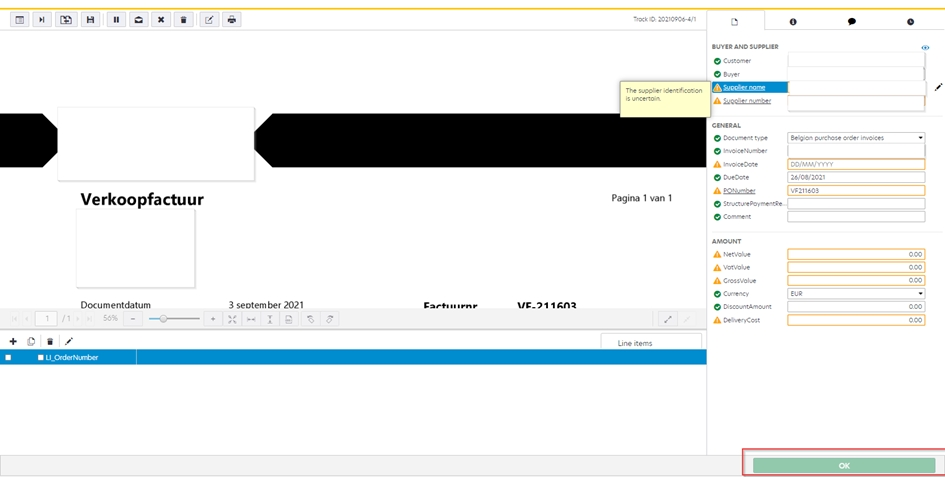
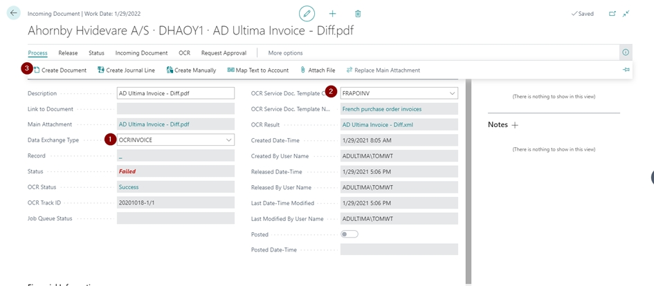
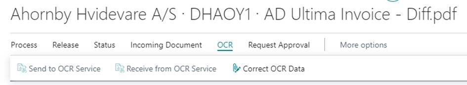
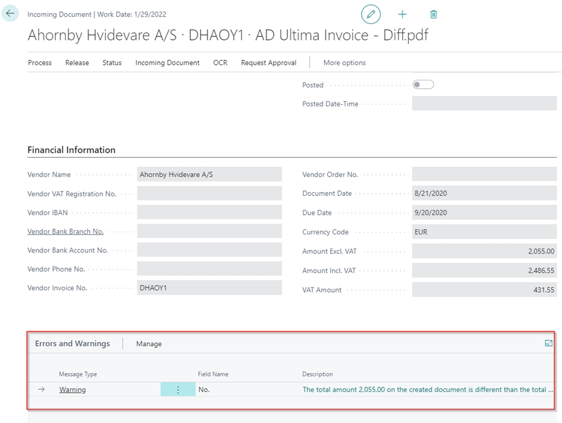
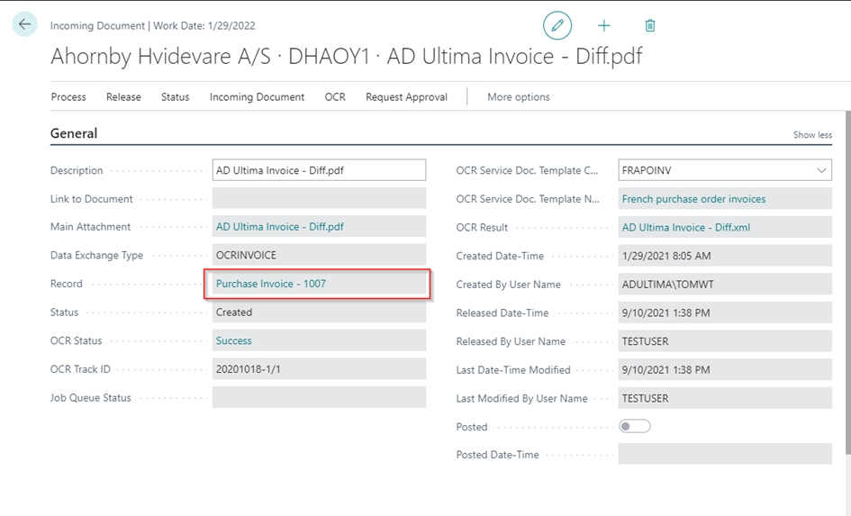

# Kofax integration

How to process the documents

1.  **Kofax**

    Upload new documents to Kofax service and verify for correctness. Upload the document through "OK" button to Business Central

    <figure><figcaption></figcaption></figure>
2.  **Business Central**

    

    Verify that the fields marked by a number have been Identified by the system and are correctly represented by the Input In Kofax.

    If OCR Is wrongly read In Kofax, there Is a possibility to correct It In this screen via the OCR button and click "correct OCR Data"

    If all Information Is correct create a document (see below) this will move the record to a newly created purchase Invoice record. If any errors or warnings are found during this process, a pop-up will tell you and under the errors and warning tab a detailed warning message will be shown.
3.

    Navigate to the newly created purchase invoice record by clicking the record field.

    From here on out we follow default BC logic for further processing of the purchaseinvoices.
4.

    <figure><figcaption></figcaption></figure>

    <figure><figcaption></figcaption></figure>

    <figure><figcaption></figcaption></figure>
