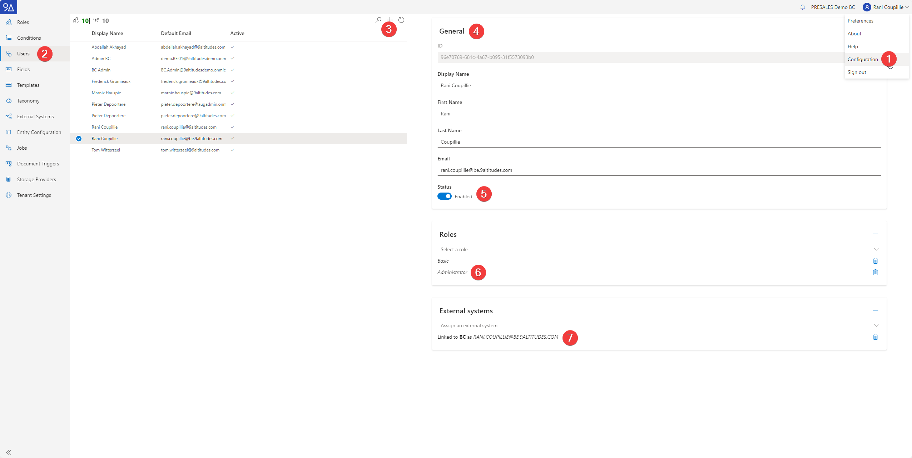
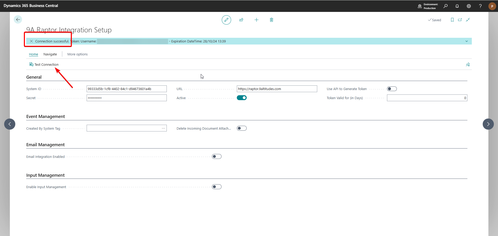

# Set up integration Raptor - BC

## Raptor setup: configuration

Go to https://raptor.9altitudes.com

### 1. Add Business Central as an external system&#x20;

Configuration -> external systems -> add an external system (BC)&#x20;

<figure><figcaption></figcaption></figure>

* make sure the 'Public'-toggle is on&#x20;

Add the ID and secret to your password manager&#x20;

* These are application keys, **and you will see them only now (!) so save them to your password manager**
* Once you have created the system, you must add at least one user to the system.&#x20;
* Important note: button ‘Renew secrets’ : use this ONLY when the secret is compromised

### 2. Set up the Raptor users&#x20;

Make sure to do this for every user&#x20;

<figure><figcaption></figcaption></figure>

* Step 1 - 3: add a user&#x20;
* Step 4: fill in the general information&#x20;
  * Make sure to use the email address linked to the BC environment
* Step 5: switch the 'Enabled' toggle on  &#x20;
  * Note: we do not remove users, because we always need the reference so we can show information about i.e.: the uploader of a document. A disabled user will not be able to login to the UI, or get any data from the API gateway&#x20;
* Step 6: add one or more roles&#x20;
  * Basic = default role that is added automatically to a new user&#x20;
  * You can also assign the administrator role&#x20;
* Step 7: assign at least one external system to the user
  * In this case: assign BC as an external system&#x20;
  * This is the system you want the user to be able to access Raptor directly from within that system

## Check Azure App Registration&#x20;

Note: the set up is normally already done by a technical, so you just need to check it&#x20;

Go to https://entra.microsoft.com

### 1. Check the application ID&#x20;

<figure><figcaption></figcaption></figure>

### 2. Check API permissions

<figure><figcaption></figcaption></figure>

This normally happens automatically

API permissions should include&#x20;

* API.ReadWrite.All (= access to APIs and webservices)
* Automation.ReadWrite.All (= full access to automation)

## BC setup: configuration&#x20;

### 1. Set up users in BC&#x20;

**Please note: This step is no longer necessary from version 23.6.378 onwards**

_User setup - page -> New_&#x20;

* _User ID: add the BC ID that you wish to add as a Raptor User_
* _9A Raptor User Login: add the same email address you set up as a user in Raptor_

<figure><figcaption></figcaption></figure>

### 2. User permissions&#x20;

Users - page -> User Card -> User Permission Sets (FastTab)&#x20;

Make sure the following permission sets are delegated to the user

* NAL Raptor Core
* NAL Raptor Email
* NAL Raptor Output

<figure><figcaption></figcaption></figure>

### 3. 9A Raptor Integration Setup&#x20;

9A Raptor Integration Setup - page -> General FastTab

* System ID: enter the ID of your external system&#x20;
* Secret: Azure app registration secret (technical who does the onboarding will provide this in the password manager)
* URL: https://raptor.9altitudes.com
  * Make sure it is always this URL _(Not: raptor.adultima.com)_&#x20;
* Active: toggle on will automatically be triggered when the setup is completed

<figure><figcaption></figcaption></figure>

### 4. Set up the Microsoft Entra Application&#x20;

Microsoft Entra Application - page&#x20;

* Client ID = Azure Application ID&#x20;
* Make sure the user permissions sets are set up as in the following image

<figure><figcaption></figcaption></figure>

* To successfully perform the taxonomy job, you sometimes need the SUPER (DATA) permission.

### 5. Test connection&#x20;

9A Raptor Integration Setup - page

* Click on the ‘Test Connection’-action&#x20;
* When the connection failed, make sure to run through the steps again about the setup (in Raptor and BC)

<figure><figcaption></figcaption></figure>

