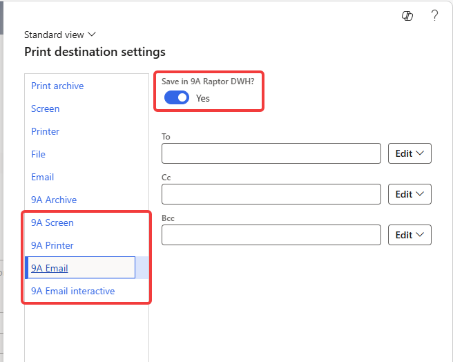

# Output management

In **9A Raptor DWH > Setup > 9A Raptor Document Warehouse parameters**, you are able to configure providers for document creation outside of the standard SSRS or Business Documents.

Options are:

* SmartFlows
* dox42 (recommended by 9A)
* XperiDo

## SmartFlows

To connect to a SmartFlows environment, you need to provide the environment URL (https://your-company.smartflows.xpertdoc.eu) as well as an API Key, generated in the SmartFlows administration console.

## dox42

To connect to a dox42 environment, you need to provide the environment URL (https://your-company.dox42.online/dox42restService.ashx).

Next to the environment an Azure app registration needs to be created as well as a service account to communicate with a linked SharePoint instance (which holds the document templates).

To create the app registration, follow these steps:

<figure><figcaption></figcaption></figure>

<figure><figcaption></figcaption></figure>

The value for the redirect URL is customer specific and will be provided after a new Dox42 environment has been ordered. This typically is https://\<customername>.dox42.online

Make sure a secret key is generated in the Certificates & secrets tab.

In the API permission section make sure the following permissions are set:

<figure><figcaption>
A A R
</figcaption></figure>

&#x20;

Don't forget to grant administrator access!

## XperiDo

To use XperiDo as an output provider, the related configuration key should be activated via configuration key Ex Arte Raptor > Output management. This configuration key Is disabled by default. As XperiDo is end-of-life, this is only supported for existing XperiDo customers.

To activate XperiDo, fill in the URL, username and password for the XperiDo webservice.

## Enable report logging

The 'Enable report logging' setting can enabled to log all requests to the output providers. This setting can be useful for troubleshooting. The logs are written to the report at 9A Raptor DWH > Inquiries and reports > Output management > Report logging.

## Archiving processing mode

The 'Archiving processing mode' setting can be used to change the behaviour of the archiving of generated documents. If the 'Save in 9A Raptor DWH' option is set in the print destination settings and the destination is not '9A Archive' itself, then the 'Archiving processing mode' has an effect.

<figure><figcaption></figcaption></figure>

The 'Archiving processing mode' options are:

* Synchronous: Archiving is done immediately after printing.
* Asynchronous: After printing, the archiving request is put in a queue table.
* Synchronous outside transaction: After printing and if the code is running inside a transaction, then the archiving request is put in a queue table. If the code is not running inside a transaction, then the archiving is done immediately after printing.

An example flow of the 'Synchronous outside transaction' is the intercompany direct delivery flow where the intercompany sales order invoice triggers the sales order invoice of the end customer that can be set to be printed during posting.

If the setting is not set to 'Synchronous', then the asynchronous part needs to be scheduled using [#Archive queued reports](../output-management/#archive-queued-reports)

