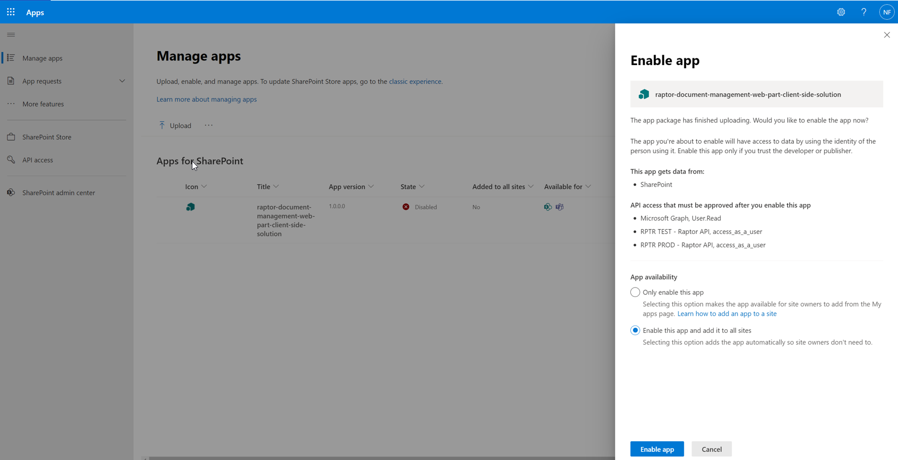
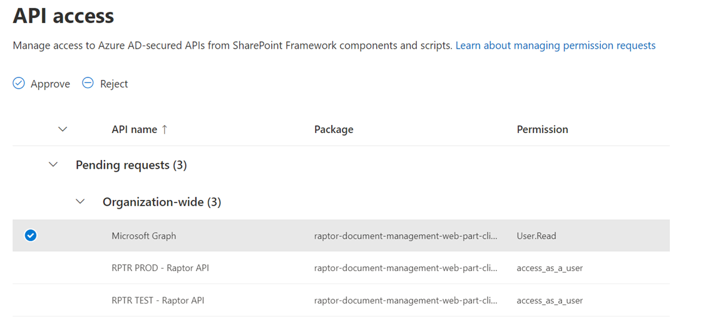
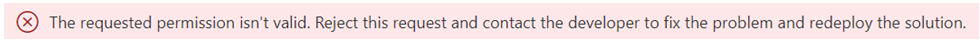
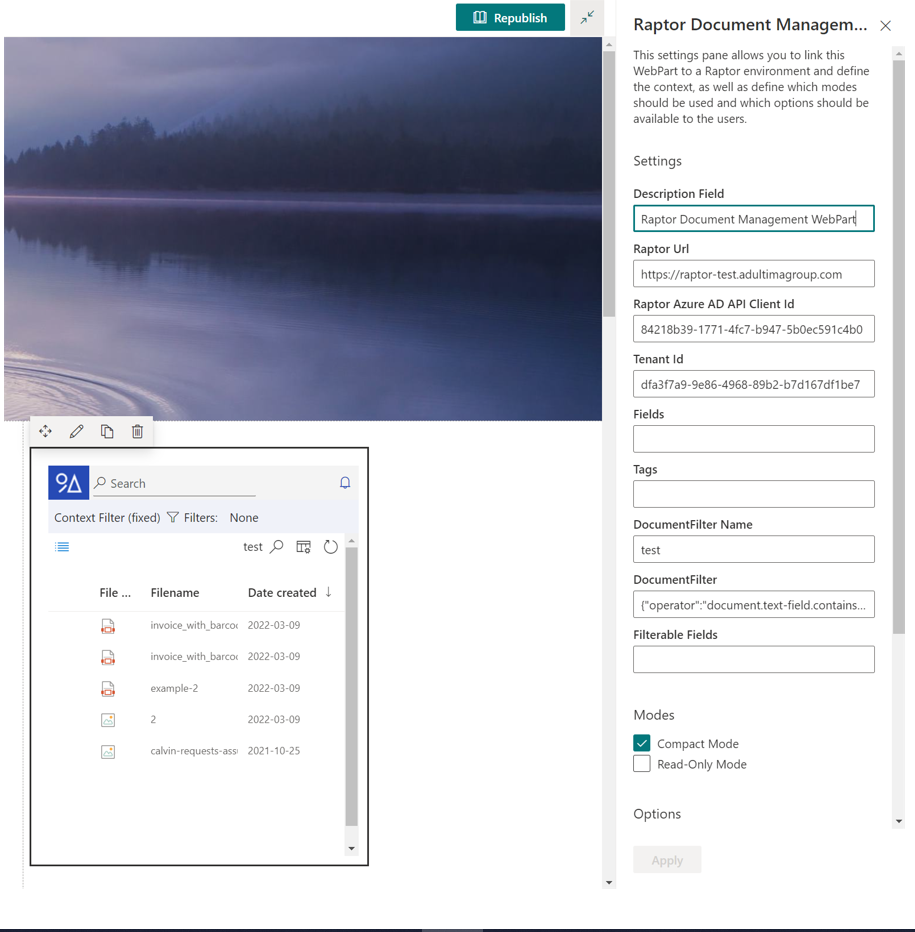
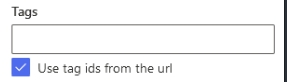
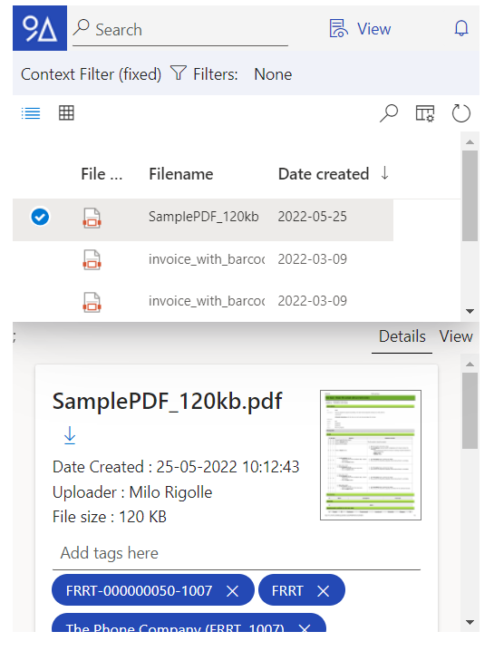
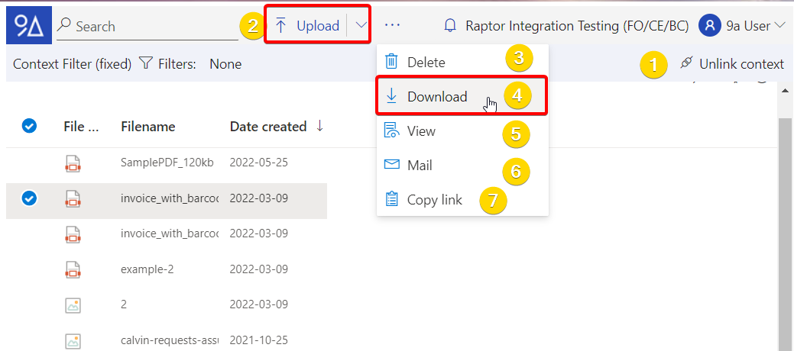

# SharePoint

The 9A Raptor DWH SharePoint webpart allows you to integrate 9A Raptor DWH in your SharePoint site.&#x20;

The install package can be requested to a 9A consultant, it contains an .sppkg file that can be uploaded to your SharePoint app catalog.

**Prerequisite**: make sure a global admin has consent to the Raptor API app registrationt. This can be done by going to https://raptor.9altitudes.com/apigateway/swagger, clicking 'Authorize' and authorizing for the access\_as\_a\_user scope. If no consent has been given yet, the administrator will get a popup screen to give permission on behalf of the organisation.\
.png>)

**Installing the webpart:**

<figure><figcaption></figcaption></figure>

Grant access to the required APIs. For customers, the 'Microsoft Graph' and 'RPTR PROD - Raptor API' permissions are sufficient.

<figure><figcaption></figcaption></figure>

If you receive the following error message, please check if the prerequisite mentioned above was executed:

After installation, it's just a matter of adding the web part to a site/page of your choice and configuring the settings.

The Raptor widget has following functions:

* **Move the web part**: This allows the widget to be repositioned within SharePoint.
* **Edit the web part**: This makes it possible wto change the widget's settings.
* **Duplicate the webpart**: This makes it possbile to duplicate the current widget
* **Remove the webpart**: Remove the current widget.

When you click on edit web part, the setting pane opens. Here it is possible to change certain settings.

<figure><figcaption></figcaption></figure>

**Description Field**: The description field allows you to change the description of the widget.

**Raptor Url**: This is the url to the raptor environment, for customers this should always be https://raptor.9altitudes.com.

**Raptor Azure AD API Client Id**: This is the app registration ID for the Raptor API. For customers this should always be 67776919-ed19-4647-aef4-f291e4e41f18.

**Tenant Id**: The tenant id can be found in the Raptor environment under "About".

**Fields**: Makes it possible to apply the search term to the fields, put a comma between two fields.This can be achieved by copying the query.

**Tags**: Makes it possible to apply the search term to the tags, put a comma between two tags. This can be achieved by copying the query. A new option is to **use tag ids from url**, you can fill url with tagIds= tagId1,tagId2 etc...

**DocumentFilter Name**: When copying the queryn it is possible to give it a name.

**DocumentFilter**: The document filter allow you to filter on documents.

**Filterable Fields**: The filter allow you to filter on fields.

**Modes**: In compact mode, the detail panel only appears when you click on it. If this function is off, both panels are displayed below each other.

**The read-only mode**: The read only mode makes it possible to read only the document, not delete or modify them.

**Disabel context detach**: (1)

**Disable upload**: disable the upload button (2)

**Disable download**: disable the download button (4)

**Disable view**: disable or enable the view (5)

**Disable email**:disable or enable the email function (6)

**Disable copy**: disable or enable the copy link function (7)

**Disable delete**: disable or enable the delete button (3)

**Disable external source**: disable the exteral source in configuration.

**Disable Document triggers**: disable the document triggers in configurtion.

**Disable User options**: disable or enable user configuration (8)

**Disable tenant name**:Show the tenant name (9)

<figure><figcaption></figcaption></figure>

**Click on apply and republish the site, to see the chosen result**

<figure><figcaption></figcaption></figure>

