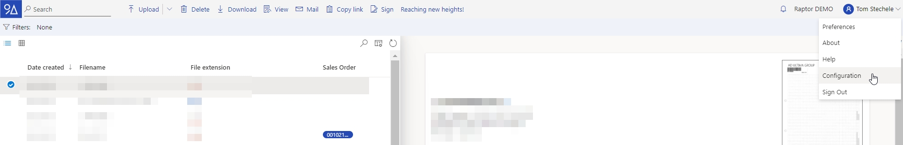

# Configuration

The Configuration page of the 9A Raptor DWH allows administrators to configure and customize the tenant to the user's needs. Examples are adding users, creating tags or integrating in external systems.

## Accessing the Configuration page

1. Open the raptor website and log in
2.  Select “Configuration"

    

Note: in case the “Configuration” option is not available you are not an administrator. Ask an administrator of the tenant to grant you access to the configuration page.
