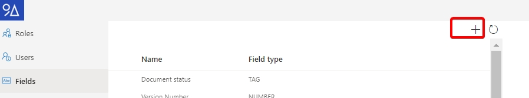

# Fields

Fields allow to add extra meta data to a document in a structured way.

A field exists of:

* Code _(unique)_
* Label
* Required
* Read only
* Type
  * Text
  * Number
  * Date
  * Tag (!)
  * User
  * Time Stamp
  * Time Span (duration)
* Row amount ( creating a multi lines - only for tag fields)
* Default value (optional)
* Validation expression _(optional, regular expression)_

You can see, modify and create new fields in the Fields tab of the configuration page.

Just like tags, fields have a code, which must be unique.

Fields can be of type date, text, number or user.&#x20;

The tag field is a special kind. It acts as a filter on all the tags linked to the document.&#x20;

An example: a document has many tags, and you want to hightlight those that are referring to customers, then you can add a field of type tag, and select a tag that is the parent of all the customers. This will then result in a list of selected customers.

This also helps when you want to add a customer, if you would just try to add the tag in the general tag section at the top, there could be many other tag suggestions like projects for the customer etcetera. But when you start typing the name of a tag in a tag field, only tags that are “descendant” of the customer tag will be suggested (and allowed).

It is not possible to set validation expressions on tag fields, or restrict the possible tags that could be added here, since it is always possible to add any tag to a document.

## Create a field

When you want to create a field, you should know these things:

* The unique code for the field
* The type of data
* In case of a tag field: the parent tag

If you have that information, you can proceed by:

1. Navigating to the configuration page
2. Select the “Fields” tab.
3. Click on the “+” button at the top of the field
4. Enter the pre-requisit information.
5.  Save the field, and make any other changes (default value, validation …)

    

## Edit a field

To edit a field, navigate to the configuration page, select the “Fields” tab, and find the field you want to modify in the list. Select that field and you can modify several of it’s properties.

Important Note: you cannot change the type, or the validation expression of the field after it is used by at least one document.

<figure><figcaption></figcaption></figure>

## General options

**Required**

The ‘Required’ toggle on a field defines if the field is expected to have a value on each document. A ‘\*’ will appear next to the field indicating this to the user. When a document has a required field with no value, it will be marked as ‘Incomplete’.

.png>)

**Read only**

The ‘Read only’ toggle will disable the field when turned on, so that it can only be edited through the API. This could be useful if you want the field to be only informational, or when it should only be edited by external processes that use the API to edit the metadata of the document.

The tag field in this case is an exception, as tags can still be added/removed from the ‘Tags’ input on top of the document detail form, thus making users able to edit the tag field even if it read-only.

Read only fields can be added or removed by users if the user role allows it.

## Details

**Validation Expression**

A validation expression is a regular expression that must match the value of field. IF the validation fails, the value cannot be saved. If a validation is configured, it is also possible to define a “validation message” which can be shown to a user if the validation fails.

For example: on a number you could add this regular expression: **$\d?\d^** this would allow to add minimum 1 digit, and maximum two digits without a coma or decimal separator. Basically allowing you to enter a positive number in the range: \[0, 99].

Remark: the regular expression is always executed on a string, and it is serialized using the invariant culture.

**Format**

Some field types like Time Stamps and Time Spans, can have a format applied to them.\
This format parameter will influence how those fields are displayed to the user, but note that different users can still see differently formatted values, based on the language (culture) they are using.



The format is passed in as a single text string, that can have following codes:

**yyyy** for the full year with 4 digits, or **yy** for only the last 2 digits.\
**MMM** for the month fully spelled out, **MMM** for the abrivated name of the momnth, **MM** for 2 digits months, M for single digit month. (some cultures always use 2 digits)\
**dddd** for the day of the month fully spelled out, **ddd** for the abreviated day of the month, **dd** for 2 digit days, **d** for single digit day.

**H** to include the hours, in 24h format, single digit.\
**HH** to include the hour in 24h format, double digit.\
**h** to include the hour in 12h format single digit\
**hh** 12h format, double digit\
**s** to include seconds in the time part.\
**t** to add am/pm (when in 24h mode)\
**z** to add time zone information

\
 



**d** for adding the number of days\
**hh**, or **h** hours (12h clock)\
**HH**, or **H** for hous (24h clock)\
**mm**, or **m** for minutes\
**ss**, or **s** for seconds\
**f**, **ff** or **fff** for fractional seconds\
**a** for the A.M / P.M. indicator\
\
You can use : and . for separaters between each segment.



**About**

Any field can be added to any document at most once.

If a field is part of the selected template, it cannot be removed. Otherwise it can be removed.

(Note that a template can always be changed, so there is no way to prevent the user to remove a field.)

**Remarks**

The type of a field cannot be changed once the field is created (and used) by at least one document.

