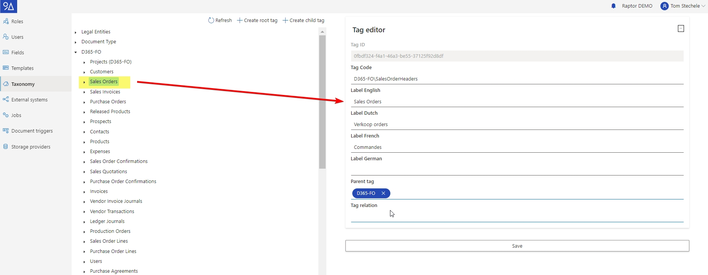
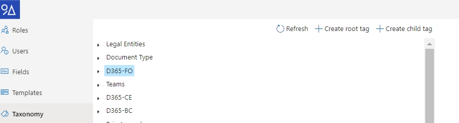

# Taxonomy

In 9A Raptor DWH, the Taxonomy refers to a hierarchal structure of tags. Tags are atomic values that can be assigned to documents as metadata to easily filter, search or secure them.&#x20;

Each tag can have a parent tag, thus creating a tree-like structure. The taxonomy is therefore often referred to as the Tag tree.

**Synced Tags** or **Automatically created tags**, are tags that where created through an external system or by a Taxonomy job. These tags typically represent rows from tables from in an external system and are often used to filter documents linked to a record.

**Manual Tags** are tags that are manually created by the user, usually referring to static metadata such as document types e.g. the tag "Sales Invoice".

<figure><figcaption>
The taxonomy tree visible in the configuration panel
</figcaption></figure>

## Tag details

When you select a tag in the Taxonomy, it will show you several details of that tag:

The **Id** is the tag's unique identifier in the 9A Raptor DWH tenant. This id is automatically generated when creating a tag and can be used to retrieve it using the 9A Raptor DWH API.

The **Code** is the tag's unique key. Unlike the Id, the tag code is defined by the user or the Entity Configuration. Tag codes usually have a fixed structure and contain values that make the tag unique.&#x20;

\
An example could be the Sales Invoice tag code "D365-FO\SalesInvoice\FRRT\SI00001".\
This tag code is unique as there is only one Sales Invoice in the company FRRT which uses the number SI00001. Tag codes were introduced as they have two advantages:

1\) Retrieving tags\
When a system needs to find specific tags, it might not be aware of the tag's ID. However, often times the system has specific information about the tag it wants to find. In the example above, we know that we're looking for the tag that represents Sales Invoice SI00001 in company FRRT. Because of Entity configuration, we also know that tag codes for sales invoices are formatted as "D365-FO\SalesInvoice\\\<COMPANY>\\\<SALES INVOICE NUMBER>".

By putting this information together, any system is able to retrieve a certain tag, without needing to know it's ID.

2\) Cross-tenant configuration

By using tag codes, you can implement environment independent logic. When you have a "Test" tenant which contains several document type tags, you could create the same tag (and therefore the same tag codes) in the "Production" tenant. This makes it easy to deploy solutions that use the Raptor API from one environment to the other;

**Labels** are the display text shown to the user when a tag is added to a document. It can have a different value depending on the language of the user.&#x20;

The **Parent tag** refers to the tag's parent in the Taxonomy. **Root tags** do not have a parent tag.

When **Cascading Relations** are activated, the system will make sure that documents always have all related tags. Meaning if a project has a relation to a customer, then a document that has the project tag will also have the customer tag. And the user cannot remove the customer tag.


The **Tag relation** will be read-only in case the tag was created via an Entity Configuration. If that's the case, it can be changed by updating the relations of the entity in the Entity Configuration section of the Configuration page.



**Important**

It is not possible to create two tags with the same code, not even if you have already deleted the tag. Note that tags are not really deleted from the database, they are just hidden from the UI. So you need to re-activate them instead of creating a new one.


## Changing a tag

To change an existing tag:

1. Select the tag in the tree view
2. Edit the fields in the tag editor
3. Click the save button

Note: you can only modify manually created tags. Since automatic tags will be recreated with the next sync, making any changes to them does not make a lot of sense.

Note: you can change everything except the ID of the tag. When you change the parent, all the child tags are also automatically moved to the new section in the tree.


The **Tag relation** is help tool to get an overview of which relations have been established in the entity configuration. It is therefore readonly - only the changes in entity config can be applied. If you would like to see the relationship without consulting the entity config.


## Create a new tag

To create a new tag:

1. Select the parent tag in the tree (unless you want to create a “root level” tag.)
2. Click on:
   1. “Create root tag” if you want to create a root tag.
   2. “Create child tag” if you want to create a new tag below the currently selected tag.
3.  Change the provider

    (in case of a child tag, the provider used for the parent tag is pre-selected.)
4. Set the labels (fill in all languages)
5. Fill in the Parent tag.
6. The tag relation will be automatically filled in when the entity configuration is correct.
7. Click the save button.

The tag should be visible in the tree and selected in the editor pane.

Note: changes to the taxonomy may take up to 5 minutes before they will be picked up by the search services.

## Delete a tag

Tags can only be deleted using the API.


Tags are soft-deleted, meaning they can be restored at any time after deletion.


## Tag Relations

Any tag can have relations to other tags, when a tag A has a relation configured to a tag B, any document that is tagged with A will also get tag B assigned to it.

It is possible to define on a tenant level how exactly tag relations should work. By default the tags in the tenant will work with static relations.

### Static Relations

In case of static relations, tag relations are only taken into consideration when a tag is added to the document. If that tag's relations change after that, the document will remain unchanged.&#x20;

Related tags could be removed by users.

### Cascading Relations

Cascading relations can be activated on tenant level and will make sure that changes to tags and tag relations have a cascading effect on documents.

When a tag relation is modified, all existing documents are updated to reflect the new situation. By consequence, tags added to a document through relations cannot be removed as they are now in sync with the tag's definition.

Users can "pin" tags added by relations to ensure that those tags will not be removed from the document should the relations of the "source tag" change.

#### **An example**

The image below shows the result of adding the "Customer 2" tag to a document when the tenant is configured with "cascading relations". the two relations on the customer indicate the language all documents should have when communicating to the customer, and the legal entity used for that legal entity.

In this case the legal entity is incorrectly set to "DAT", but when the relation would be fixed, the document will receive an update and get the correct tag.

If the user would remove the "Customer 2" tag from the document both other tags will automatically be removed as well, since they were not explicitly added (fixated) to the document.

If the user want to keep the "English" tag, then it is possible to fixate the tag on the document by clicking the "pin" icon on the right-side of the tag. That would result in 2 tags with a 'x' and the "DAT" tag with the pin icon.

<figure><figcaption>
example of cascading relations
</figcaption></figure>

Note: if one of the "related tags" for "Customer 2" would be fixed on the document, the user could try to remove the tag using the 'x' button. However, the tag will not be removed since the tag relations force it on the document. But the UI will reflect the change by showing the "pin" icon again.

#### Reasons for using cascading relations

Cascading relations might be useful in scenarios where a tag's relation can change after it was added to a document. This is often the case for tags that are being synchronised from external systems, which might get additional relations when new fields become available.

With static relations, those documents would be "missing" those new tags. As a result we modified the behaviour of our solution, and allow customers to choose between one or the other.

The cascading relations will soon become the default for new customers that are onboarded with the D9A Kickstart.

### Impact of switching between both modes

Both activating and disabling cascading relations has an impact on the system. Meaning that if you activate it, and then disable it again, the tags on your document may have changed.

#### Duration

Switching modes requires updates to the info stored in our database; as a result we have to loop over all documents in the tenant to check what impact the operation has on that document. This can take a while before all documents are updated to the new mode. Considering that this operation would be a "one of" occurrence, we have decided to run this migration as low prio background job. This should not have a noticeable performance impact on end users.

Depending on the amount of documents in the tenant the operation can take hours to a few days to complete.&#x20;

You can keep using the system while this migration, new documents will be instantly affected by the new mode.

#### Activating cascading relations

It is possible that some document are missing tags that are defined in the relations. They will be updated to include the extra tag's.

No tags will be removed from the documents.

All existing tags on the document will be considered to be added "explicitly" on the document. This is because we cannot know for sure that a tag was added as part of a relation, or explicitly; and happens to just also be part of a relation.&#x20;

#### Activating static relations

When we deactivate the cascading relations we loose the information about how a tag was added on the document (explicitly, or implicitly via a tag relation). All tags that were assigned to the document at the time of the migration of that document will be added as tags.

#### Configuring cascading relations

There is a setting available that shows the configuration, and can switch between both modes. You can find it on the "taxonomy" page, behind the 'gear' symbol.

Switching between modes is as simple as toggling the button. But be sure to know the impact of switching between both modes. To be sure a dialog window will ask for explicit confirmation that you whish to perform the switch.

<figure><figcaption>
(de)activating cascading relations
</figcaption></figure>

