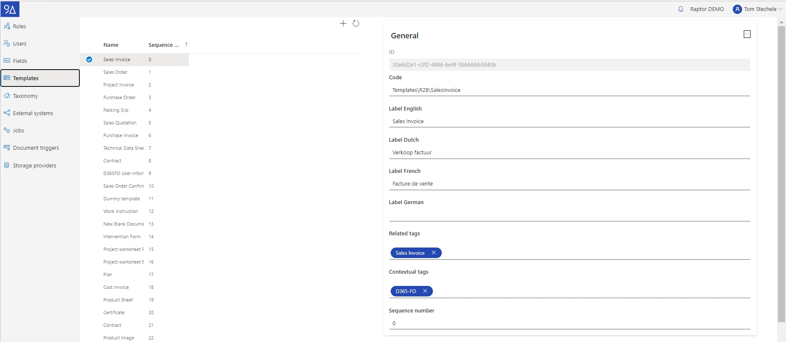

# Templates

Templates enable the grouping of fields and the assignment of default tags to a document upon template selection. When creating a template, ensure that the necessary fields for the template are in place. Optionally, you can include multiple tags that will be automatically applied to any document that is assigned this template, the **Related tags**.

### Contextual tags

Contextual tags make sure that the template is only visualised in the **drag-and-drop view** if it's present in a specific tag context. When no contextual tags are specified, the template will always be shown during drag-and-drop. The benefit of using contextual tags on templates is that users are guided into using the templates that are relevant for a specific tag context.

**An example**: The administrator only wants the template 'Sales order' to be shown, when the user has his 9A Raptor DWH view filtered on a Sales Order record. To do that, the administrator fills in the parent tag 'Sales Orders' in the contextual tags field.

<figure><figcaption></figcaption></figure>

This will make sure that, during drag-and-drop, users will only see the Sales Order template when the document list is being filtered on a Sales Order tag, or when they are not filtering on any tags at all.

In the image below, we are working in the context of sales order SO000693. The template is shown during drag and drop.

<figure><figcaption></figcaption></figure>

In the next image, we are opening Raptor in the context of vendor "Pro Bike". The template is not shown when we drag and drop here:

<figure><figcaption></figcaption></figure>

### **Creating a New Template**

**Prerequisites:**

* A unique code for the template (e.g., "templates\projects\internal-project").
* Identification of the fields to be added to the template.

**Steps:**

1. Click on the “+” button located at the top of the list displaying all templates.
2. Enter the unique code for the template.
3. Specify the display name for each language.
4. Optionally, add tags that should be automatically included in the “Related tags” field.
5. Include a list of fields belonging to the template, ensuring the order mirrors the desired user display order.
6. Click the save button.

### **Modifying a Template**

1. Select the template from the list.
2. Modify any editable field.
3. Click the save button.

#### **Sorting or Deleting a Field from a Template**

1. Hover the cursor over the field to be moved or deleted.
2. When the cursor is over the field, up and down arrows and an “x” button will appear on the right side of the screen.
3. Use the arrows to reorder fields or click the “x” button to remove a field.

_Note: Removing a field from a template doesn't erase data from documents already assigned to that field. It simply won’t be displayed as part of the template anymore._

_Note: Adding or removing a “Related tag” doesn’t impact documents already assigned to the template. The effect is seen only when a template is assigned to a document._
