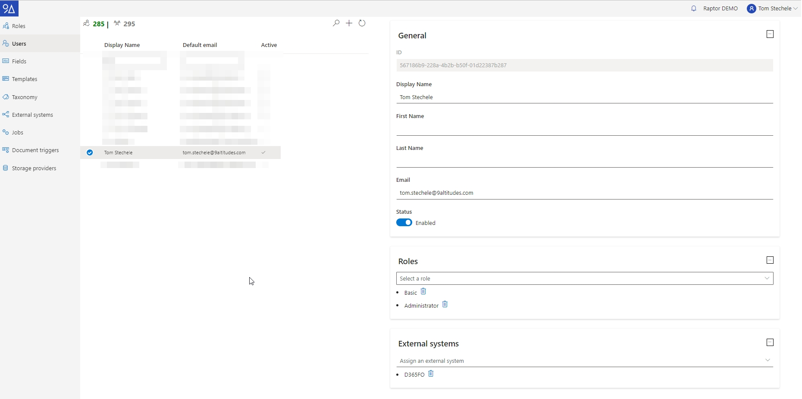
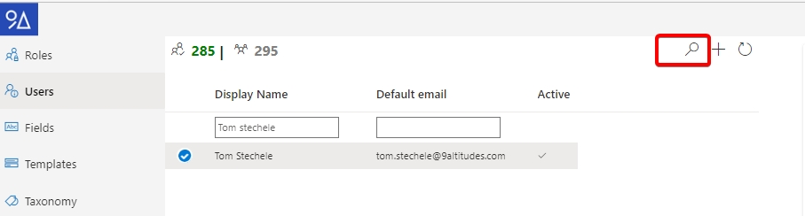
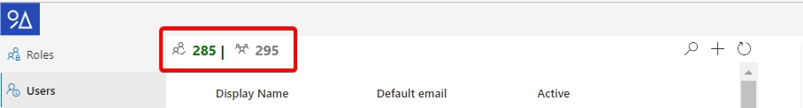
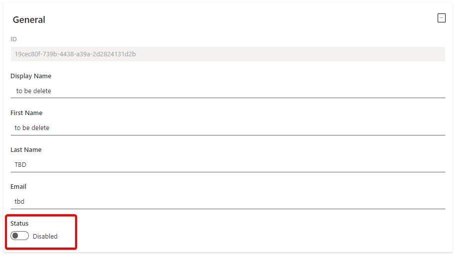

# Users

The user tab allows following actions:

* List all the (non-system) users in the system
* Add a new user
* Assign / revoke roles for a user
* (un-) Link the user to external systems
*   Disable a user.

    

## Concepts

Next to standard users, there are also:

**System users** are not displayed in this list. These are users who cannot directly login on the stand alone user interface, but can interact with Document Warehouse using the API.

An example of a system user could be the user created to connect the “E-Platform” module to 9A Raptor DWH.

**Non-editable users:** are created and managed by a user sync. Currently we only offer a user sync for D365-FO users. When users are synced this way, the user-sync job can and will update the details for that user. And as a result the fields like “First Name”, “Last Name”, “Email”, … will be greyed out.

## Searching for user

To search for a user, click on the “magnifying icon” at the top of the list. This will add two text boxes in the table just below the header where a name, or email can be entered.

## Counters

At the top left of the user table there are two counters available. One lists the number of ‘active’ (normal) users, and the other the total number of users in the system. (including system users)

## Disable a user

First select the user, then check if the “Status” slider is disabled or not. If it is, the user was created using a D365-FO sync job, and you have to remove/disable the user in the D365-FO environment. Else the user was manually created, and can be manually disabled.

Note: we do not remove users, because we always need the reference so we can show information about i.e.: the uploader of a document. A disabled user will not be able to login to the UI, or get any data from the API gateway.

## Add or remove a user from an external system

Removing a user from an external system is as simple as clicking on the “bin” icon next to the external systems name. Note that if this is the “D365-FO” system, and the user is automatically synced with the sync job, the user will automatically be reassigned to this group the next time the job is executed.

Adding a user is just as simple; except with one caveat: you cannot define the users “external id” when you do it from the user editor page. In this case the default value will be used which is the users email address.

Should the user be known to the external system under another ID, then you have to manage this under the “External Systems” tab.


What is an external system?

_This is any other component that automatically log in users when showing the UI, or can ask questions to the API gateway of Document Warehouse._


## Adding users

**Add users to 9A Raptor DWH & Link with external system**

1. Open 9A Raptor DWH as a user with administrator privileges: [https://raptor.adultimagroup.com](https://raptor.adultimagroup.com/)
2.  Go to ‘Configuration’

    <figure><figcaption></figcaption></figure>
3.  Fill in user e-mail, first and last name. Confirm by choosing ‘Save’.

    <figure><figcaption></figcaption></figure>
4.  A default role will be added automatically to the new user (you can add or change this afterwards)

    <figure><figcaption></figcaption></figure>
5. Make sure to link the user to at least one external system (for example D365FO as ERP or CRM) if you want the user to be able to access 9A Raptor DWH directly from within that system.

##
