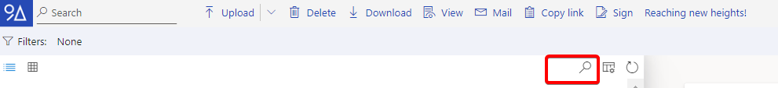
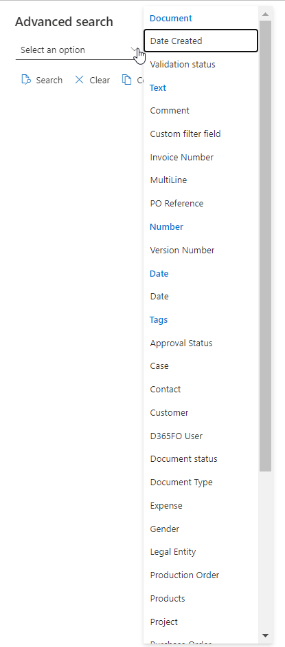
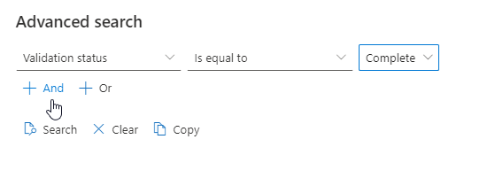
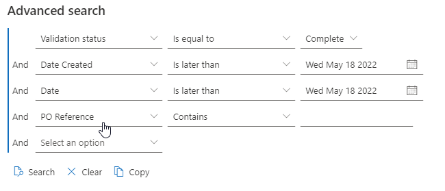
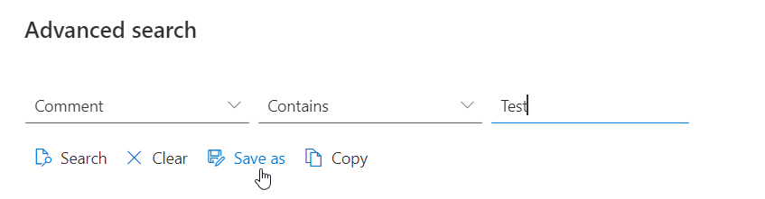
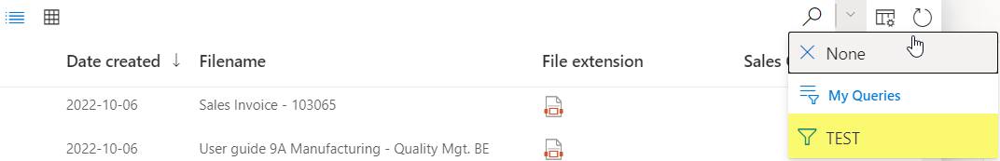

# Search for a file

File search is case-insensitive.

You can use tag filters during file search, see [Broken link](/broken/pages/pm7pa6aPCMifqyqXe15W "mention")

<figure><figcaption></figcaption></figure>

1. In the Search... field (1) , enter (part of) the file name.
2. Press Enter. Now only the files with a name containing your letter/number combination are shown

Use the advanced search

Clicking on the magnifying glass opens the advanced search. There is it possible to search more specifically with more options.

Next you can chose between **Document** - **Text - Number - Date - Tags**

The next step is, that it is possible to sort by different values. In this case it is possible to set the validation status equal to/ or not equal to complete. This makes it possible to sort on different validation statuses

Next, you can added as many as you want, connect them with AND/ OR.

The copy function allow to copy the query. This enable the use of the sharepoint integration with Raptor.

It is also possible to save the query and to reuse the query. Here you can see I saved the query by name: "Test"

## Filter files using tag filters

File search is case-insensitive.

You can refine your results by adding new tag filters.

You can re-extend your results, clearing a tag filter or all tag filters.

1.  In the **Search**... field, start typing the tag filter.

    When the entered letter/number combination matches tags, the search function is of the type-ahead or instant search type and shows all remaining tags matching your letter/number combination.
2.  Select a tag corresponding to the file you are looking for.

    Only the files in the list .png>)  Filtered tags: are shown.

### Filter files using date fields

When you go to the advanced search, there is the possibility to select any of the date fields in your system. By default you can use the calendar icon to open a date picker to select a specific date; and you have the option to choose "equals", "less then" or "greater then".

It is also possible to select a "dynamic" date; this can be useful when used in saved queries.

For example, instead of searching for document with "Due by" is less then 2024-01-31, you could now create a "Due By" equals "This month".

To switch to a dynamic date you can hover over the date field date picker, and a switch type button will appear. Click on it, and the date will be switched to "today". Now you can click again on the calendar icon and a small configuration screen will appear.

Here you have 3 options

* One of "**today**", "**tomorrow**", or "**yesterday**".\
  Simple & probably the most common use cases.
* An **offset**; meaning that it will add or removes a certain amount of days, weeks, months or years to the "current date". The result will be a single day (/date).
* To pick a **range**; for example "this week", "next month", "last year", ...

How does the Range option work?

* Date **Equals** matches all documents that have the date field in the range.
* Date **Less then** matches all documents that have the date field with a value lower then the start of the range.
* Date **Greater then** matches all documents that have the date field with a value greater then the end of the range.

### About Extended ranges

It is possible to extend a range with a certain amount; for example by selecting "next 3 weeks", you will get a range of 3 weeks starting next week and then extending 3 weeks in the future.

When you pick "last 2 weeks", you get a 2 week range that equals last week and the week before that.

If you pick "Last -2 weeks", you get a range of 2 weeks again; which starts last week, and includes "this week".

So basically: if the range starts with "this" or "next", a positive numeric value will extend the end of the range. And a negative value will extend the start of the range (back in time)

But if you have a range starting with "last", then a positive number will extend the start of the range to start earlier, and will leave the end of the range as is. And a negative number will extend the end of the range while keeping the start of the range.

Note that this configurator does not allow to create advanced ranges like a range of 17 days starting 2 weeks from now. But most common situations should be achievable; if needed by combining multiple ranges in 'AND' / 'OR' combinations.

### About the time zone

The current date depends on where you are due to time zones. For example, if it's January 23rd in Brussels, it might still be January 22nd in Washington, D.C. To make sure the dynamic date function works well it is important to pick the correct time zone. By default our user interface will assume "Europe/Brussels" since this should fit most of our user base. But it is possible to pick any time zone you want.

