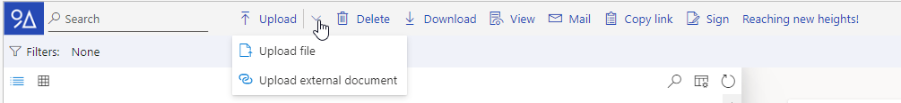
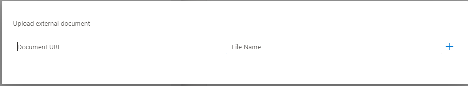

# Uploading files

Multiple file upload is possible.

You can also upload files via drag and drop, see Drag and drop file upload.


When you upload a file via a linked Dynamics 365 environment, the tags of the content will be added automatically to the file in the Document Warehouse System.


1.  .png>)Click  Upload.

    Explorer opens.
2. Browse to the file folder.
3. Select the file(s).
4.  Click Open.

    The pop-up window File Upload appears.

<figure><figcaption></figcaption></figure>

5. **Result:** It is also possible to upload an external document. When you chose this option you must enter a URL and the file name of the external document so that you can upload the file.

6. Select a (common) template from the drop-down menu.You can also add the template later (when you chose None) or change the template later (when you chose an available template).
7. Click Save.

The uploading starts and the file(s) will be available in the list/thumbnails.

As long as a file is uploading, 'Busy uploading' is displayed.

When the upload is completed, the label 'NEW' marks the uploaded files during two hours

When the uploaded files are not listed yet, click .png>)  refresh and/or sort the files descending by Date Created.

Files in the list with empty mandatory fields, are labelled as 'INCOMPLETE'. Mandatory fields are marked with an asterisk (\*).

Files in the list with a wrong expression used or files who do not match regurlary expression, are labeled as 'INVALID'.

## Drag and drop file upload


When you upload a file via a linked Dynamics 365 environment, the tags of the content will be added automatically to the file in the Document Warehouse System.



Multiple file upload is possible.



You can also upload files with the upload button



1. Browse for the file folder in Explorer.
2. Select the file(s).
3.  Drag the selection to the desired template in the9A Raptor DWH system.

    The templates appear while hovering over the files in the system.
4.  Add common information (in the fields) and select common information (from the drop-down menus) for you files.

    Mandatory fields are marked with an asterisk (\*) and the files will be labelled as 'INCOMPLETE' if the information is not entered in this step. You an add/edit this information later.
5.  Click Save.

    The uploading starts and the file(s) will be available in the list/thumbnails.

    As long as a file is uploading, 'Busy uploading' is displayed.

    When the upload is completed, the label 'NEW' marks the uploaded files during two hours.

    When the uploaded files are not listed yet, click .png>)  refresh and/or sort the files descending by Date Created.
